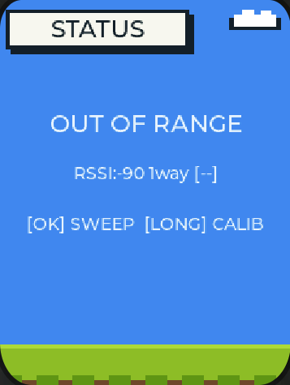
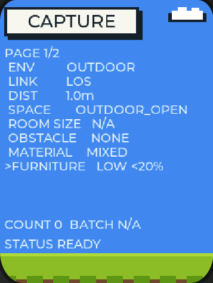
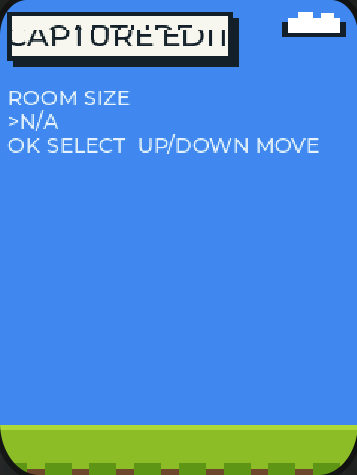
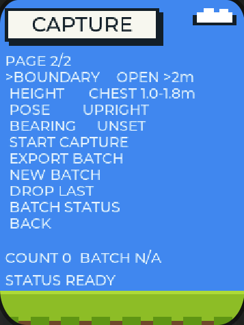
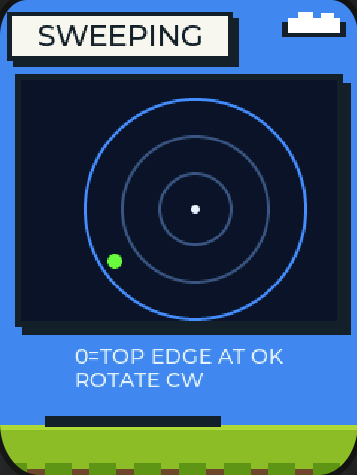

# Capture Walkthrough (Illustrated)

English | [简体中文](capture-walkthrough.zh_CN.md)

## Help Us Capture Data — Just 10 Minutes

We are training a radar ranging model and need ranging data from real environments. **Capturing takes two AI Passport cards working together**: one stays fixed on a table as the **radar base** (it never moves), the other is the **target card** that you carry around. The two cards measure distance over Wi-Fi automatically — you only place the card and press a few buttons.

## Step 1: Set the Environment (about 1 minute)

On the main page, **tap OK** to enter the capture menu (double-click UP to reach the diagnostics page, then OK):

1. **ENV**: INDOOR if you are inside, OUTDOOR if outside
2. **LINK**: LOS with nothing in between; STATIC if a wall or a still person blocks the path; DYNAMIC if something moves in between (people walking, foliage swaying); MULTIPATH near large glass or metal surfaces
3. **DIST**: how far you plan to hold the target card from the base — 8 steps from 1 to 30 m, pick the real distance
4. **SPACE through MATERIAL**: describe where the base sits (room or corridor, size, obstructions, material). When unsure, keep the defaults. In the editor, UP/DOWN selects and OK confirms:

   

Keep pressing DOWN to reach page 2:

5. **HEIGHT**: how high you hold the target card. LOW below 1 m (e.g. on a table); CHEST 1.0–1.8 m (held at chest); OVERHEAD above 1.8 m
6. **POSE**: the card's orientation. UPRIGHT (as you normally hold it); FLAT (screen up on a table); MIXED for both
7. **BEARING**: after standing in place, which side of the base the target card is on. FRONT if it faces the base, REAR behind, and so on. **This one is mandatory — the run will not start without it**

## Step 2: Capture (about 30 seconds each)

Select **START CAPTURE** in the menu and tap OK, then place the target card at the chosen distance and direction and **keep it still**. About 30 seconds later it finishes automatically, the data is saved, and the COUNT at the bottom of the menu goes up by one.

We recommend **3–5 captures** per environment. Between captures you can change DIST, BEARING or HEIGHT.

## Step 3: Another Environment (optional)

Move to another room or go outside, set ENV and LINK again, and capture 3–5 more.

## Step 4: Upload (about 1 minute)

Back on the main page, **double-click DOWN** — the base signs the data and opens a hotspot. Join it with your phone, let the browser open the upload page automatically, tap upload, and wait for the success message.

## If You Made a Mistake

- Delete only the last one: choose **DROP LAST** in the menu and confirm — earlier captures stay untouched
- Start over completely: choose **NEW BATCH** (wipes the whole batch, use carefully)

## Notes

1. During the 30-second capture, keep both the base and the target card still
2. Data lives only on the base card until uploaded — please upload soon after capturing
3. Each base keeps its own data; there is no batch count limit
4. Playing and capturing need no prior network setup

Thank you for your help!
